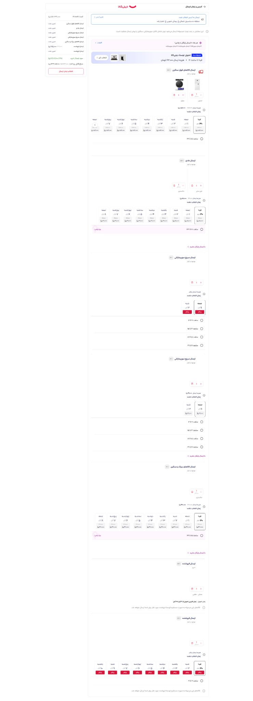

# Storefront shipping — user-approved interaction reference

Status: USER_APPROVED_TARGET_UX — IMPLEMENTATION_ACCEPTANCE_PENDING
Decision ID: SHIPPING-STOREFRONT-UX-001
Approved: 2026-10-21 (Asia/Tehran)
Owner: Product owner / Software Architecture
Scope: Tooba customer shipping step; independent delivery groups, costs and delivery-time selection.

## Authority and source

The product owner supplied the attached Digikala checkout screenshot and explicitly confirmed:
«این نهایت به این شکل باید توسط مشتری دیده بشود متوجه شدی»
The owner then requested that this decision and the actual image be committed as durable repository evidence.

Original attachment: `www.digikala.com_checkout_shipping_.png`
SHA-256 of unmodified attachment: `a0c3e884d238eeeb39726ccabb593bbaf3694afe9cc7305975109cb776f3c489`
The image is an external visual/interaction reference supplied by the owner, not a Tooba runtime screenshot.
It proves the requested experience; it does not prove implementation, testing or user acceptance of Tooba.

## Binding customer experience

1. Present the cart as clearly separated delivery groups, each with its own included products.
2. Each group shows a human-readable delivery type / responsible sender as appropriate, its shipping cost and its own delivery timing.
3. Where supported by authoritative availability, the customer independently selects a delivery date and a time window for each group, as in the reference's date buttons and time-window radio choices.
4. Changing one group's shipping option, date or window must not reset another group's valid selections. Revalidate affected availability explicitly; never silently discard choices.
5. A seller identity alone does not define a delivery group. One seller may require separate groups for incompatible shipping needs, such as ordinary and heavy goods.
6. Customer choices must be usable delivery options, not raw service/option bindings, GUIDs, backend codes, configuration gates or architecture explanations.
7. Show each group's cost and the overall shipping total consistently. A delivery group and a physical parcel are distinct concepts; do not promise one tracking number merely because items appear together.
8. Never fabricate a date, slot or guaranteed capacity. Estimated delivery and a reservable delivery window must be distinguished. Missing authority is an explicit capability gap, not permission to display fake slots.
9. Preserve Tooba's accepted Shopeiva visual system, Persian RTL, localization and responsive behavior. This reference fixes interaction semantics, not an instruction to copy Digikala branding, exact styling or every label.
10. Group separation, cost and time must be backed by server validation and retained in the accepted order snapshot. Browser state is not shipping or financial authority.

## What the screenshot does NOT decide

The screenshot does not reveal Digikala's internal grouping algorithm, database, ownership model, settlement rules or carrier integrations.
Do not infer that different sellers can always be merged, or that identical shipping methods imply one shipment.
Do not hard-code the screenshot's category labels as an exhaustive taxonomy.
Admin/seller permissions, trusted origins, rule conflicts, scheduling, parcel construction and financial integrations still require explicit compatible architecture.
This decision does not authorize production flag changes, weakening existing guards, a new implementation task or claiming release readiness.

## Related approved direction

Current work priority is Admin correction and acceptance first, then Storefront and deployment.
The customer must not navigate Admin concepts such as shipping templates, geographic restrictions or pricing policies.
Administrative geography is selected once for a rule, may contain multiple non-overlapping geographic scopes, and is reused by dependent settings; the customer's checkout uses the destination address to evaluate these rules.
This note records confirmed direction, not approval of every design proposal from the surrounding discussion.

## Mandatory review and acceptance

Before designing, implementing or reviewing shipping-related Admin, seller or Storefront behavior that affects customer delivery groups, costs or timing, read this document and inspect its image.
Assess changes against the numbered requirements; an implementation/test PASS is not user visual acceptance.
Do not silently replace this target with a flat seller-only list or a bare carrier picker without independent group timing.
Any proposed change to this approved experience requires an explicit product-owner decision recorded in this document's history.
If existing locks conflict, report the exact conflict and obtain the architectural resolution; do not bypass guards or silently reinterpret this reference.
Record unresolved capabilities honestly. Final acceptance needs the actual Tooba customer flow, including independent group selections and persisted cost/time consistency.

## Related repository references

- [Independent delivery commitment](SHIPPING-GROUP-INDEPENDENT-DELIVERY-COMMITMENT.md)
- [Shipping architect handoff](../../planning/shipping/SHIPPING-ARCHITECT-RECOVERY-2026-10-16.md)
- [Shipping fee decision](../checkout/SHIPPING-GROUP-FEE-ALLOCATION-POLICY-DECISION.md)
